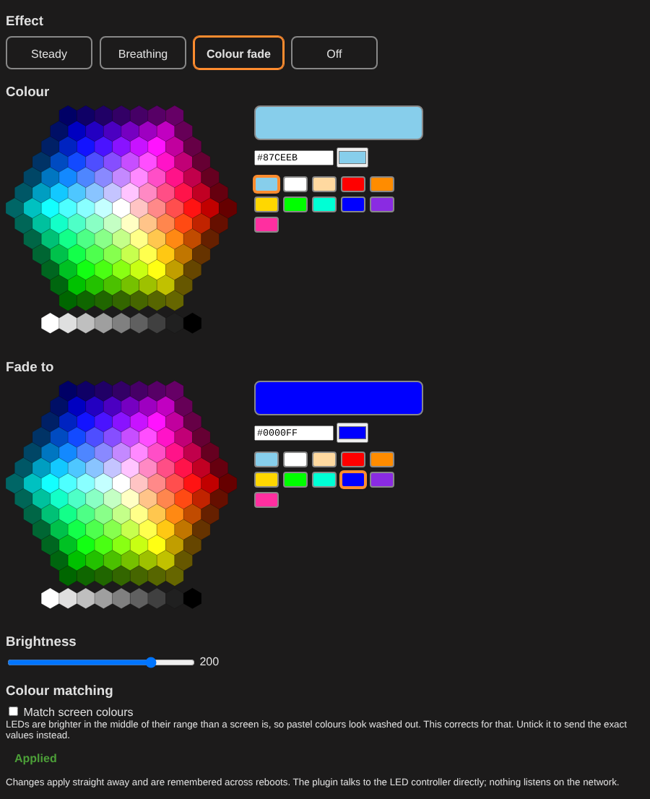

# LincStation N1 LED for Unraid

An Unraid plugin that controls the RGB light bar and status LEDs on the **LincStation N1**. Pick an effect and a colour from the Unraid web interface and the LEDs change straight away. The choice is remembered across reboots.

The plugin talks to the LED controller directly over I2C, so there is **no background service and no open network port**.



## Why this exists

The LincStation N1 ships with a customised build of Unraid. Hidden inside it is an undocumented service, `go_8130_led_linux`, that runs at boot, controls the LEDs, and listens for unauthenticated HTTP requests on port 50000. I did not like having an undocumented program that I had not chosen running on my NAS.

So I installed Unraid from the official source instead. That removed the vendor service, and with it the ability to control the LEDs: the light bar and status LEDs simply stopped being configurable.

I wanted both: a clean, official Unraid install and working LEDs. I worked out how the vendor service drives the LED controller (the register map is in [docs/PROTOCOL.md](docs/PROTOCOL.md)) and wrote this plugin. It does the same job, with the controls in **Settings** where they belong, the source code open for anyone to read, and nothing listening on the network.

## Features

- Effects: steady, breathing, colour fade (two colours) and off
- Hexagon colour picker, preset colours, hex code entry and a brightness slider
- "Match screen colours" option, so pastel colours such as sky blue look right on the LEDs
- Applies instantly, saved on the flash drive, restored at boot
- Nothing listens on the network by default
- Dark and light icons that follow your Unraid theme
- Optional HTTP API mode, compatible with the vendor service, for Home Assistant and scripts (see [docs/PROTOCOL.md](docs/PROTOCOL.md))

## Requirements

- LincStation N1 running Unraid 6.9 or newer
- The `i2c-dev` kernel module (the plugin loads it for you)

Other LincStation models may use a different controller. The plugin only writes to I2C bus 0, address `0x26`, so do not use it on other hardware.

## Install

1. In Unraid, open **Plugins > Install Plugin**.
2. Paste this address and press **Install**:

   ```
   https://github.com/OWNER/REPO/releases/latest/download/lincstation-led.plg
   ```

3. When it finishes, open **Settings > Utilities > LincStation LED**.

Unraid reinstalls the plugin at every boot and the plugin restores your last colour and effect.

### Update

Open **Plugins**, choose **Check for Updates**, then update **lincstation-led**.

### Uninstall

Open **Plugins > Installed Plugins** and remove **lincstation-led**. Your saved colour stays in `/boot/config/plugins/lincstation-led/state` and is harmless to delete.

### Moving from the vendor build

If you are still on the LincStation build of Unraid, the vendor service already controls the LEDs and listens on port 50000, so remove or stop it first or the two will fight over the controller. If you reinstalled official Unraid, as described above, there is nothing to remove. Either way, delete any `lincstation-led` or `go_8130_led_linux` lines you added to `/boot/config/go` (edit with `vim /boot/config/go`). The plugin stops a running copy of its own binary when it installs.

## Using it

Open **Settings > Utilities > LincStation LED**.

1. Choose an **Effect**.
2. Click a hexagon, a preset, or type a hex code such as `#87CEEB`.
3. For **Colour fade**, also choose the **Fade to** colour.
4. Use the **Brightness** slider (steady and colour fade only).

If a colour looks different from what you picked, toggle **Match screen colours**.

### Command line

The same binary can be run from the Unraid terminal:

```
lincstation-led set -mode normal -color0 '#87CEEB' -light 200
lincstation-led set -mode breath -color0 '#FF2FA0'
lincstation-led set -mode loop -color0 '#FF0000' -color1 '#0000FF' -light 150
lincstation-led set -mode off
lincstation-led get          # print the saved state as JSON
lincstation-led restore      # re-apply the saved state (done at boot)
```

### Home Assistant and other scripts

By default nothing listens on the network. If you want the HTTP API, run the binary in server mode from your own startup script:

```
/usr/local/sbin/lincstation-led -port 50000 -bind 127.0.0.1
```

Leave out `-bind` to listen on all interfaces. There is no password, so only do that on a trusted network. Do not run server mode and use the settings page at the same time, because they keep separate copies of the saved state. The endpoints are listed in [docs/PROTOCOL.md](docs/PROTOCOL.md).

## Troubleshooting

| Problem | What to try |
| --- | --- |
| The page says "Applied" but nothing changes | Run `ls /dev/i2c-*`. If it shows nothing, run `modprobe i2c-dev`. Check `/var/log/lincstation-led.log`. |
| Colours look washed out | Turn on **Match screen colours**. |
| The menu entry or icon is missing | Refresh the browser. The icon changes with your theme when you open the page or reboot. |
| Install fails with a download error | Check the server has internet access and that the release exists on the GitHub releases page. |
| The colour reverts after a reboot | Check that `/boot/config/plugins/lincstation-led/state/rgb` exists after you pick a colour. |

## Build from source

You need Go 1.21 or newer and Python 3.

```
git clone https://github.com/OWNER/REPO.git
cd REPO
make lint test       # needs bash, php and node for the lint step
make build REPO=OWNER/REPO
```

The package and installer are written to `dist/`. The Go code has no third-party dependencies and builds to one static binary.

## How it works

- `lincstation-led set` validates the request, writes the registers through the Linux I2C interface and saves the choice to `/boot/config/plugins/lincstation-led/state`.
- The settings page calls a small PHP endpoint that runs that command with whitelisted arguments.
- `/etc/rc.d/rc.lincstation-led restore` runs when the plugin is installed at boot and re-applies the saved state.

The register map is in [docs/PROTOCOL.md](docs/PROTOCOL.md). It was worked out by watching what the vendor service writes to the controller. No vendor code is included in this repository.

## Disclaimer

This is an independent project. It is not made, endorsed or supported by LincStation or Lime Technology (Unraid). Product names and the device drawing used for the icon belong to their owners. The plugin writes only to the LED registers listed in the protocol notes, but you use it at your own risk.

## Licence

[MIT](LICENSE)
